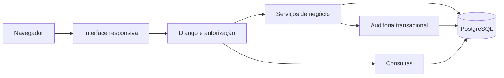

# EduCore — Plataforma de Gestão Educacional

**Uma experiência integrada de gestão acadêmica, administrativa e financeira.**

[**Explorar demonstração pública**](https://educore-demo-k196.onrender.com/) · [**Acessar apresentação do sistema**](https://educore-demo-k196.onrender.com/)

   

## Visão geral

O **EduCore** é uma aplicação web demonstrativa para centralizar processos de uma instituição de ensino. Conecta alunos, cursos, turmas, matrículas, chamadas, frequência e operações financeiras simuladas em uma experiência responsiva.

> Projeto independente para aprendizado e portfólio, com dados fictícios. Não homologado para uso operacional com dados reais.

## Experimente a apresentação

**[Abrir vitrine interativa do EduCore →](https://educore-demo-k196.onrender.com/)**

A vitrine é pública e apresenta a jornada **aluno → turma → matrícula → chamada → frequência**. O acesso administrativo exige uma conta individual; não são distribuídas credenciais públicas. A hospedagem gratuita pode demorar a iniciar após inatividade.

## Funcionalidades implementadas

| Área | O que faz |
| --- | --- |
| Dashboard | Indicadores de alunos, cursos, turmas, vagas, frequência e financeiro, conforme permissões. |
| Alunos | Cadastro, edição, pesquisa, filtros, paginação e desativação lógica. |
| Acadêmico | Cursos, disciplinas, turmas, ofertas e associações docentes. |
| Matrículas | Matrícula, trancamento, retomada, transferência, cancelamento e conclusão manual com histórico. |
| Chamada | Registro de presença, falta e justificativa, correções motivadas e cancelamento auditado. |
| Frequência | Percentuais por disciplina e matrícula, contagens e alertas demonstrativos. |
| Financeiro | Planos, parcelas, pagamentos parciais simulados, ajustes, estornos integrais autorizados e relatórios CSV. |
| Auditoria | Registro transacional de operações críticas em matrículas, chamadas e financeiro. |
| Interface | Layout responsivo, temas claro/escuro, foco visível e preferência por movimento reduzido. |

**Não implementados nesta versão:** contratos/PDF, notas, certificados, portal completo do aluno/professor, assinatura eletrônica, autopresença/QR Code, integração bancária e cobrança automática.

## Perfis de acesso

Cinco papéis organizam a experiência: **Administrador, Secretaria, Supervisor, Professor e Aluno**. As permissões são verificadas no servidor, inclusive com escopo por registro onde necessário. O portal completo do aluno ainda não foi implementado.

## Arquitetura e decisões técnicas

- **Backend:** Python 3.12 e Django 5.2 LTS, em monólito modular por domínio.
- **Persistência:** PostgreSQL, com integridade relacional e transações.
- **Autorização:** sessões, proteção CSRF e permissões verificadas no backend.
- **Concorrência:** operações críticas utilizam transações e bloqueios de registros.
- **Financeiro:** cálculos com precisão decimal e histórico das operações simuladas.
- **Frontend:** templates Django, CSS e JavaScript, com acessibilidade progressiva.

## Dados de demonstração e qualidade

O cenário integrado descrito na versão de 28/10/2026 contempla **240 alunos fictícios, oito cursos, 16 turmas e 272 vínculos históricos**. A suíte de testes do projeto privado registrou **292 testes aprovados em PostgreSQL 17.11** em 28/10/2026, incluindo verificações de integridade e fluxos de negócio. Esses números são evidências datadas, não indicadores dinâmicos.

## Limitações e evolução

O projeto é um demonstrativo técnico, não uma implantação de produção. O financeiro não movimenta dinheiro real. A auditoria não cobre todas as edições e leituras. Estornos são integrais; estornos parciais não estão disponíveis. O aceite em dispositivos físicos, auditoria externa de segurança e avaliações completas de acessibilidade permanecem pendentes.

Próximas evoluções consideradas: portal do aluno e professor, notas, certificados, documentos, contratos e melhorias na experiência pública. Itens planejados não são apresentados como funcionalidades prontas.

## Sobre este repositório

**Este repositório é exclusivamente um showcase.** Não contém o código-fonte do EduCore, instruções de instalação, arquivos de configuração, bancos de dados ou credenciais. A demonstração está disponível pelo link acima.

O código da aplicação permanece em um repositório privado. A publicação deste material não concede licença para redistribuir a implementação.

## Autoria

Projeto de **Jonas Pessoa**. O EduCore apresenta soluções de arquitetura, modelagem de dados, integridade transacional, controle de acesso e interfaces para gestão educacional.
